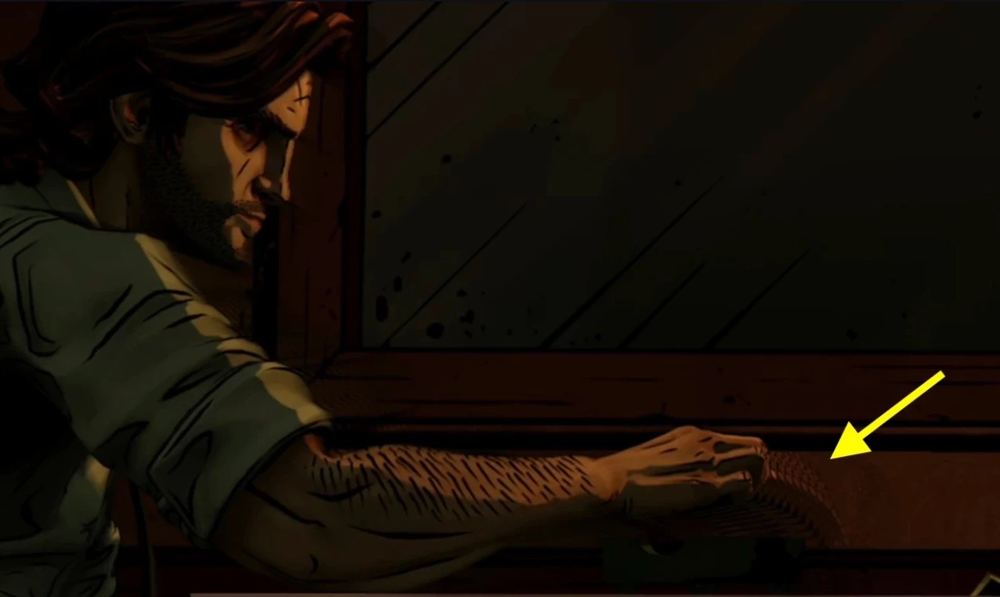
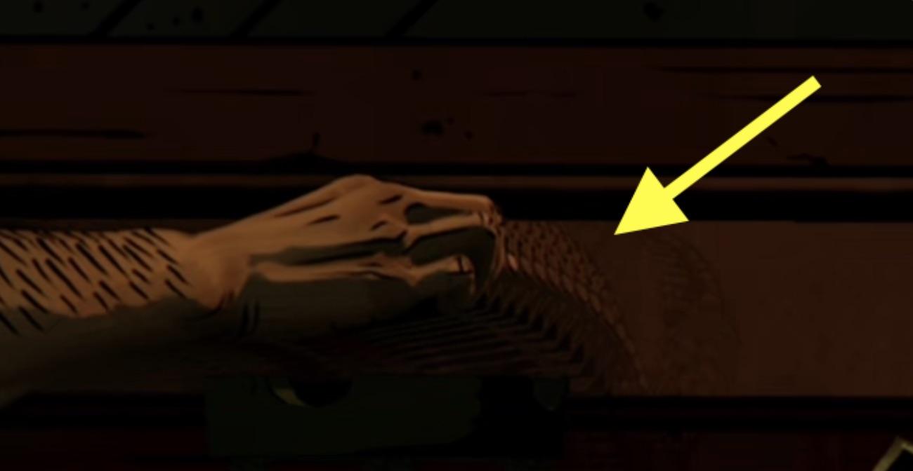
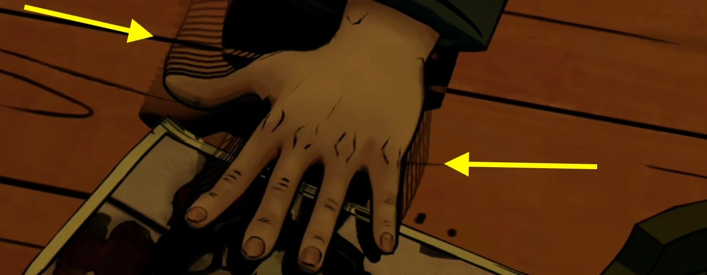
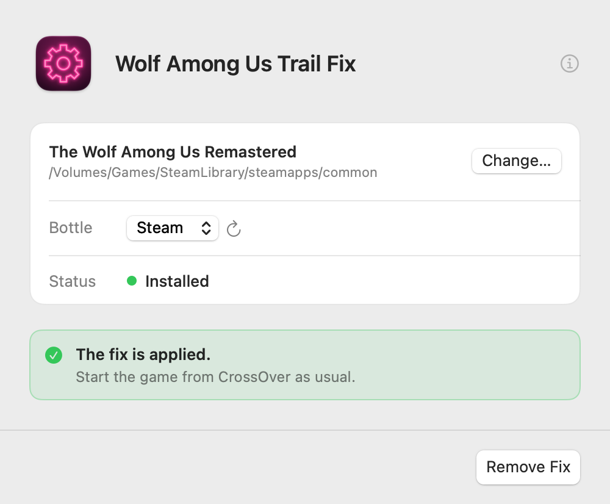

# Wolf Among Us Trail Fix

Fixes the motion trails in The Wolf Among Us Remastered on Apple Silicon Macs, played through
CrossOver: anything that moves leaves faded copies of itself behind.

## The problem

 

## The app

## How to use it

1. [Download the latest release](https://github.com/macprotips/WolfAmongUsFix/releases/latest)
   (`Wolf-Among-Us-Trail-Fix.zip`) and unzip it.
2. Quit the game, then quit Steam inside CrossOver (**Steam › Exit**), then quit CrossOver
   itself (**CrossOver › Quit CrossOver**).
3. Open the app. It finds the game by itself, even in a Steam library on an external drive;
   otherwise drag **The Wolf Among Us Remastered** folder (the one with
   `TheWolfAmongUsRemastered.exe`) into its window.
4. Click **Apply Fix**, then start the game from CrossOver as usual.

**Remove Fix** in the same window puts everything back. Quit Steam and CrossOver first for
that too.

> [!NOTE]
> This fix changes a setting in your CrossOver bottle. CodeWeavers can't support CrossOver
> while the fix is applied. Before contacting CrossOver support, click **Remove Fix** to put
> the bottle back as it was.

## What's wrong, and what the fix does

With anti-aliasing on, the game uses TAA with 8x MSAA. Apple GPUs don't have 8x, and D3DMetal
(the graphics layer CrossOver uses) reports that, but when the game asks for an 8x texture it
gets a 4x one instead of an error. The game's shaders still read 8 samples per pixel, and the
4 missing ones read as black. With black always in the mix, the TAA never throws away dark
parts of old frames, so shadows and edges leave trails behind anything that moves.
[`vendor-report/`](vendor-report/) has a small test program that shows this.

The fix is a small `d3d11.dll` in the game folder, plus one Wine setting in the bottle
(`d3d11 = native,builtin` for TheWolfAmongUsRemastered.exe). When the game creates its
shaders, the DLL makes the reads of the missing samples use the 4 that exist, and passes
everything else straight to D3DMetal. It does nothing if 8x really works. The game's files
and CrossOver aren't changed, and no game files are included here.

## Building it

- The DLL: `./build.sh` (needs `brew install mingw-w64`); source in [`fix/`](fix/), tests in
  [`tests/`](tests/) (`tests/run.sh`).
- The app: `app/build-app.sh` on an Apple Silicon Mac (runs the tests, builds and signs the
  app). Source in [`app/`](app/).

Public domain ([Unlicense](LICENSE)). Not affiliated with the makers or publishers of The Wolf
Among Us.
